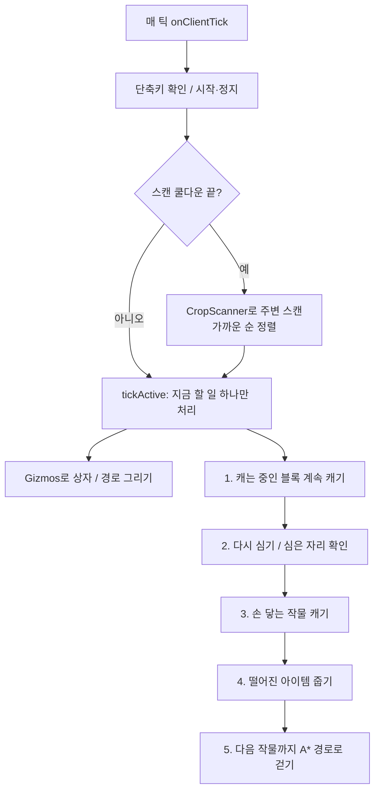

# AutoFarm

Forge 26.2용 클라이언트 모드입니다.
주변 작물을 찾아가서 캐고, 다시 심고, 떨어진 아이템까지 주워 옵니다. 빈 경작지에 씨앗 심는 기능도 있습니다.

## 만든 목적 / 사용 책임

윤리적인 목적으로 만든 모드입니다. Forge 모드 개발이나 길찾기 공부용, 그리고 싱글플레이처럼 써도 되는 환경에서 반복 농사를 편하게 하려고 만들었습니다.

어디서 어떻게 쓸지는 사용자가 정하는 것이고, 그 결과에 대한 책임도 사용자에게 있습니다.
서버에 따라 매크로나 자동화 모드를 금지하는 곳이 많으니, 서버에서 쓰기 전에 규칙은 직접 확인하세요. 규칙을 어겨서 생기는 경고, 밴 같은 불이익은 제작자가 책임지지 않습니다.
"사람처럼" 모드는 움직임을 자연스럽게 보이게 하는 기능일 뿐이고, 서버 규칙을 피해 가라고 만든 게 아닙니다. 남의 농장이나 보호 구역에서 허락 없이 쓰는 것도 하지 마세요.

## 단축키

- Delete : 수확 (다 캐면 멈춤)
- End : 반복 수확 (안 멈추고 계속 대기하면서 자라는 대로 캠)
- Home : 빈 경작지에 씨앗 심기
- Insert : 설정 화면

같은 키를 한 번 더 누르면 멈춥니다. 키는 조작 설정의 AutoFarm 항목에서 바꿀 수 있습니다.

## 기능

수확 (Delete)
- 범위 안에서 다 자란 작물을 가까운 것부터 찾아가서 캡니다.
- 캔 자리에 씨앗을 다시 심고, 떨어진 아이템을 주우러 갑니다.
- 밀, 당근, 감자, 비트, 네더 사마귀, 코코아, 달콤한 열매, 사탕수수, 수박, 호박을 지원합니다. 다른 모드 작물(CropBlock)도 됩니다.
- 사탕수수는 맨 아래 한 칸을 남겨 둡니다. 수박과 호박은 줄기에 붙은 것만 캡니다.

반복 수확 (End)
- 멈추지 않고 계속 돕니다. 하나라도 다 자라면 가서 캐고 다시 심은 다음 대기합니다. 두 개가 자라면 두 개를 캡니다.
- 작물 찾는 범위는 End를 누른 위치를 기준으로 고정됩니다.
- 이 모드에서는 "다 자란 작물만" 설정과 상관없이 다 자란 것만 캡니다.

심기 (Home)
- 빈 경작지에 설정에서 고른 씨앗을 심습니다. 네더 사마귀는 영혼 모래에 심습니다.
- 인벤토리에 있는 씨앗은 알아서 핫바로 옮겨서 씁니다.

그 외
- 다시 심은 자리는 잠깐 뒤에 한 번 더 확인하고, 비어 있으면 다시 심습니다.
- 안 캐지는 작물은 정해진 횟수만큼 시도한 뒤 2분 동안 건너뜁니다.
- 수확할 작물은 초록색, 심을 자리는 파란색, 지금 가는 곳은 주황색으로 표시되고 이동 경로도 선으로 보입니다.
- 경작지가 밟혀서 망가지지 않게 꼭 필요할 때만 점프합니다.

## 움직임 모드

기계처럼
- 손 닿는 거리에서 바로 캐고, 화면도 바로 돌립니다.
- 멀리 있는 작물은 뛰어갑니다. (설정에서 끌 수 있음)

사람처럼
- 천천히 걸어서 작물 1~2칸 앞까지 간 다음 캡니다.
- 화면을 부드럽게 돌리고, 행동 사이에 조금씩 쉬는 시간이 다릅니다.
- 가끔 가장 가까운 것 말고 다른 작물부터 가거나, 조준이 살짝 빗나갔다가 맞추거나, 걷다가 옆을 보거나 합니다.
- 반복 수확으로 대기할 때는 주변을 둘러보거나 몇 칸 돌아다닙니다.

## 설치 / 사용

1. Forge 26.2 설치
2. autofarm-1.0-SNAPSHOT.jar 파일을 mods 폴더에 넣기
3. 게임 실행 후 Insert로 설정 열기
4. 수확할 작물, 심을 씨앗 고르기
5. 씨앗은 인벤토리에 넣어 두고 농장 근처에서 Delete / End / Home

## 설정

| 설정 | 기본값 | 설명 |
|---|---|---|
| 수확 범위 | 100 | 작물 찾는 반경 (4~128) |
| 수직 범위 | 8 | 위아래로 찾는 범위 |
| 다 자란 작물만 | 켜짐 | 끄면 덜 자란 것도 캠 |
| 다시 심기 | 켜짐 | 캔 자리에 다시 심기 |
| 다 자란 작물 표시 | 켜짐 | 상자로 표시 |
| 벽 너머로 보기 | 켜짐 | 표시가 블록에 안 가려짐 |
| 이동 경로 표시 | 켜짐 | 경로를 선으로 표시 |
| 행동 간격 | 2틱 | 서버에서 막히면 늘리기 |
| 줍기 | 내가 캔 것만 | 끄기 / 내가 캔 것만 / 모든 작물 |
| 심기 범위 | 16 | Home 키로 심을 범위 |
| 움직임 | 기계처럼 | 기계처럼 / 사람처럼 |
| 멀면 달리기 | 켜짐 | 기계처럼 모드에서만 |
| 안 캐지면 건너뛰기 | 켜짐 | 재시도 후 2분 동안 건너뜀 |
| 재시도 횟수 | 3 | 캐기 / 다시 심기 재시도 횟수 |
| 메뉴 열어도 계속 | 켜짐 | 채팅, ESC 메뉴 열어도 계속 동작 |

설정 파일은 config/autofarm-client.toml 입니다.

## 참고

- 싱글플레이에서 ESC 메뉴를 열면 게임이 일시정지돼서 같이 멈춥니다. LAN에 공개해 두면 계속 돕니다. 채팅창은 괜찮습니다.
- 인벤토리나 상자 창을 열면 잠깐 멈춥니다.
- 죽거나 서버에서 나가면 자동으로 꺼집니다.

## 빌드

```
gradlew build
```

build/libs 폴더에 jar가 생깁니다.

---

# 개발 정보

## 사용 기술

| 분류 | 사용한 것 |
|---|---|
| 언어 | Java 25 (record, switch 식, 패턴 매칭 instanceof) |
| 게임 / 모드 로더 | Minecraft 26.2, Minecraft Forge 65.1.5 |
| 빌드 | Gradle, ForgeGradle 7, Mojang 공식 매핑 |
| Forge API | EventBus 7 (이벤트 리스너), ForgeConfigSpec (TOML 설정), KeyMapping (단축키), ConfigScreenFactory (모드 목록 설정 버튼) |
| Minecraft API | MultiPlayerGameMode (블록 캐기 / 우클릭 / 인벤토리 조작), ClientInput (이동 입력), Gizmos (월드에 상자 / 선 그리기), Screen / 위젯 (설정 GUI), 레지스트리 (블록 / 아이템 목록) |
| 알고리즘 | A* 길찾기, 청크 섹션 단위 블록 스캔, 상위 N개 부분 선택 |
| 기타 | JSpecify `@Nullable`, 다국어 lang 파일 (한국어 / 영어) |

## 어디에 들어가는지

- 클라이언트 전용 모드입니다 (`mods.toml`의 `clientSideOnly=true`). 서버에는 아무것도 안 깔아도 됩니다.
- 내 게임의 `mods` 폴더에 jar 하나만 넣으면 됩니다.
- 설정은 `config/autofarm-client.toml`에 저장됩니다. 게임 안에서는 Insert 키나 Forge 모드 목록의 설정 버튼으로 바꿉니다.
- 블록을 캐거나 심을 때는 바닐라 클라이언트가 플레이어 조작 때 쓰는 함수(`startDestroyBlock`, `useItemOn`)를 그대로 호출합니다. 그래서 서버 입장에서는 일반 플레이어가 조작하는 것과 같은 패킷이 갑니다.

## 프로젝트 구조

```
src/main/java/org/rust/autofarm/
├── Autofarm.java              모드 진입점. 설정, 키, 이벤트 리스너 등록
├── KeyBindings.java           Delete / End / Home / Insert 단축키 정의
├── Config.java                ForgeConfigSpec 설정 정의, 불러오기 / 저장
├── FarmController.java        핵심 로직. 매 틱 상태 머신, 이동, 조준, 수확, 심기, 줍기, 표시
├── CropScanner.java           주변 청크에서 수확할 작물 / 빈 경작지 찾기
├── PathFinder.java            A* 길찾기
├── Crops.java                 작물 종류별 다 자랐는지 판단, 캐는 방법, 다시 심을 위치 계산
├── Planting.java              심을 수 있는 씨앗 목록, 땅 판단, 인벤토리 씨앗 확인
├── AutoFarmConfigScreen.java  설정 화면 (버튼, 슬라이더)
└── SelectScreen.java          작물 / 씨앗 고르는 화면 (아이콘, 페이지 넘기기)

src/main/resources/
├── META-INF/mods.toml         모드 정보
└── assets/autofarm/lang/      ko_kr.json, en_us.json
```

## 동작 흐름

`Autofarm` 생성자에서 이벤트 세 개를 등록합니다.

- `ClientTickEvent.Post` → `FarmController.onClientTick` : 매 틱(1초에 20번) 실행되는 메인 루프
- `MovementInputUpdateEvent` → `FarmController.onMovementInput` : 이동 입력 덮어쓰기
- `ClientPlayerNetworkEvent.LoggingOut` → 서버에서 나가면 정지



`tickActive`는 위에서부터 할 일이 있으면 그것만 하고 바로 돌아갑니다. 한 틱에 행동을 하나만 하니까 상태가 꼬이지 않습니다.

## 구현하면서 신경 쓴 부분

### 1. 이동은 입력으로만 처리

플레이어 위치나 속도를 직접 바꾸지 않습니다. `MovementInputUpdateEvent`에서 W/A/S/D 입력값(`moveVector`)만 바꿔서, 게임이 실제로 키를 누른 것처럼 움직이게 했습니다.
가야 할 방향(월드 좌표)은 플레이어가 보는 방향(yaw)으로 회전시켜서 앞뒤 / 좌우 입력으로 바꿉니다 (`FarmController.steer`).

### 2. 작물 스캔 최적화 (`CropScanner`)

반경 100칸이면 확인할 블록이 수십만 개라서 그냥 다 돌면 느립니다.

- 이미 로드된 청크(`ChunkStatus.FULL`)만 봅니다.
- 16x16x16 섹션 단위로 먼저 걸러냅니다. 공기만 있는 섹션(`hasOnlyAir`)이나, 팔레트에 작물 블록이 아예 없는 섹션(`maybeHas`)은 통째로 건너뜁니다.
- 거리는 제곱으로 비교해서 제곱근 계산을 안 합니다. `MutableBlockPos`를 재사용해서 객체 생성을 줄였습니다.
- 스캔은 매 틱이 아니라 10~20틱마다 한 번만 합니다.

### 3. A* 길찾기 (`PathFinder`)

- 8방향으로 이동합니다. 대각선은 양옆 두 칸이 다 비어 있을 때만 가서 모서리에 안 걸립니다.
- 한 칸 점프(비용 2), 최대 3칸 낙하를 지원합니다. 경작지 위로는 떨어지지 않습니다 (밟으면 흙이 됨).
- 물, 용암, 거미줄, 불, 선인장, 달콤한 열매 덤불, 마그마 블록은 피합니다.
- 목표는 "작물 위치에 서기"가 아니라 "손이 닿는 위치까지 가기"입니다. 그래서 휴리스틱에서 손 닿는 거리를 빼고 계산합니다.
- 블록 상태 확인 결과를 `Long` 키 HashMap에 캐시합니다. 탐색 노드는 최대 40,000개로 제한해서 못 가는 곳 때문에 게임이 멈추지 않게 했습니다.

### 4. 실패 처리

자동화는 "안 될 때 어떻게 하느냐"가 중요해서 경우마다 따로 처리했습니다.

| 상황 | 처리 |
|---|---|
| 걷다가 막힘 (40틱 동안 가까워지지 않음) | 경로 다시 계산, 3번 넘으면 그 작물을 30초 동안 제외 |
| 블록이 안 캐짐 | 5초 지나면 중단, 설정한 횟수만큼 재시도 후 2분 동안 건너뜀 |
| 다시 심었는데 안 심어짐 | 10틱 뒤에 다시 확인하고, 비어 있으면 또 심기 |
| 인벤토리가 꽉 참 | 아이템 줍기를 건너뛰고 화면에 알림 |
| 사망 / 서버 나감 | 바로 정지 |

### 5. 내가 캔 아이템만 줍기

"내가 캔 것만" 모드에서는 최근 2초 안에 캔 자리 근처에서 그 뒤에 생긴 아이템만 줍습니다. 아이템 엔티티의 `tickCount`(생긴 지 몇 틱)를 캔 시점과 비교해서, 원래 바닥에 있던 아이템과 구분합니다.

### 6. 씨앗 자동 준비

씨앗이 핫바에 있으면 그 칸을 고르고, 가방 안에만 있으면 인벤토리 SWAP 동작으로 핫바로 옮긴 다음 다음 틱에 심습니다.

### 7. 다른 모드 작물 지원

작물 목록을 하드코딩하지 않고 블록 레지스트리에서 `CropBlock`을 상속한 블록을 전부 찾습니다. 그래서 다른 모드가 추가한 작물도 따로 작업 없이 됩니다.
선택한 작물은 설정 파일에 ID 문자열로 저장하고, 실제 블록 객체로 바꾸는 건 필요할 때 한 번만 해서 캐시합니다 (`Config.Selection<T>`).

### 8. "사람처럼" 모드

| 동작 | 구현 |
|---|---|
| 화면 돌리기 | 남은 각도의 30%씩, 틱당 최대 12도까지 돌리고 아주 작은 흔들림을 더함 |
| 조준 | 작물마다 보는 위치를 조금씩 다르게 함. 30% 확률로 살짝 빗나갔다가 다시 맞춤 |
| 거리 | 작물마다 1.9~2.4칸 사이 거리를 랜덤으로 정하고, 그만큼 다가간 다음 캠 |
| 걷기 | 속도 55~75%. 가는 방향을 다 돌아보기 전에는 느리게 걸음 |
| 작물 고르기 | 70%는 가장 가까운 것, 20%는 두 번째, 10%는 세 번째 |
| 쉬기 | 15% 확률로 출발 전에 잠깐 멈춤. 행동 사이 간격도 랜덤이고 가끔 길게 쉼 |
| 대기 중 | 반복 수확으로 기다릴 때 주변을 둘러보거나 시작 위치 8칸 안에서 돌아다님 |

### 9. 화면 표시

Minecraft 26.2의 Gizmos API로 수확할 작물(초록), 심을 자리(파랑), 지금 목표(주황)를 상자로 그리고, 이동 경로는 선으로 그립니다. 작물 모양(`VoxelShape`)에 맞춰 상자 크기를 정하고, 벽 너머로도 보이게 할 수 있습니다.

### 10. 설정

- `ForgeConfigSpec`으로 TOML 설정 파일을 만들고, 불러오거나 바뀔 때 static 필드에 값을 복사해 둡니다. 매 틱 설정 값을 읽어도 부담이 없습니다.
- 설정 화면은 Forge 기본 화면이 아니라 직접 만들었습니다. 켜기/끄기 버튼, 슬라이더, 그리고 아이템 아이콘이 보이는 작물 / 씨앗 선택 화면(페이지 넘기기)이 있습니다.
